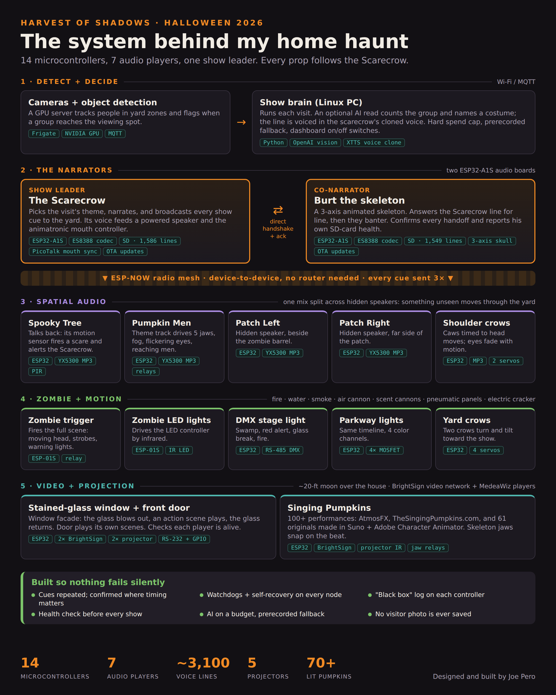
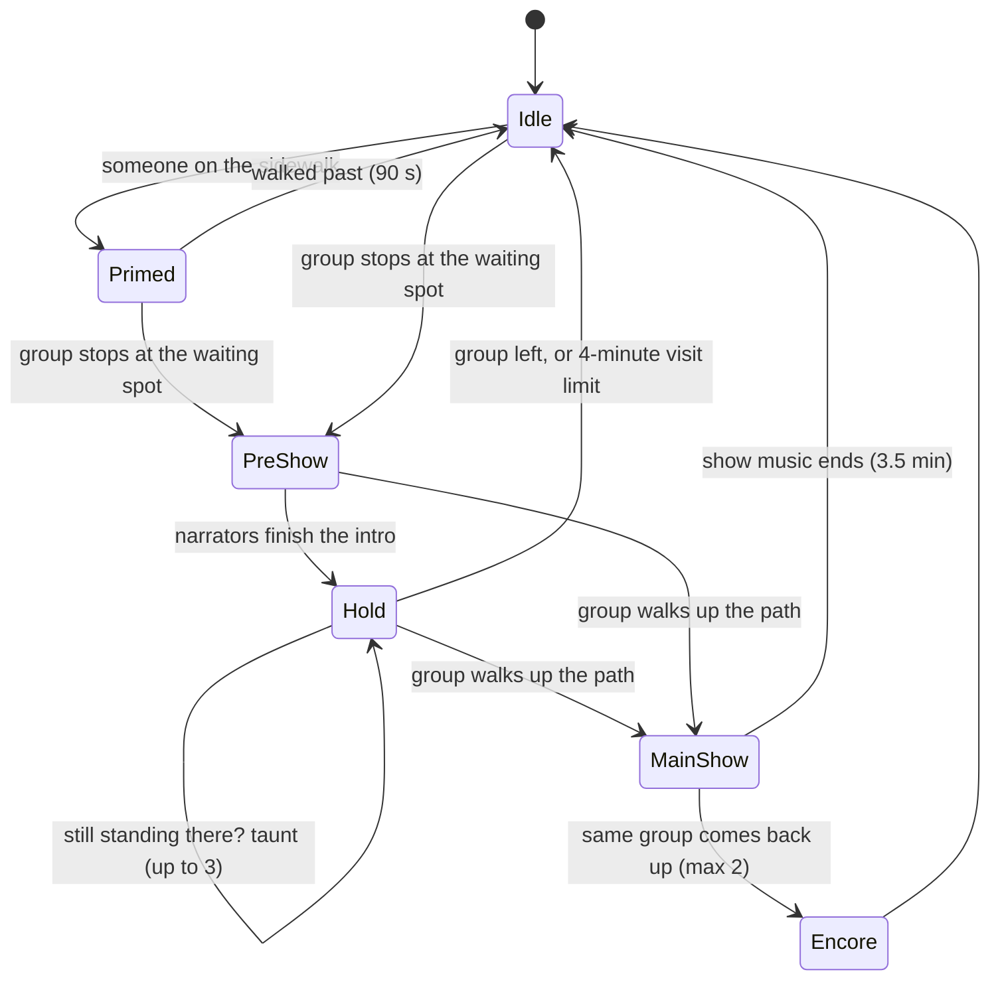
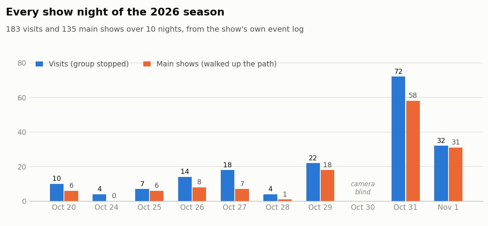
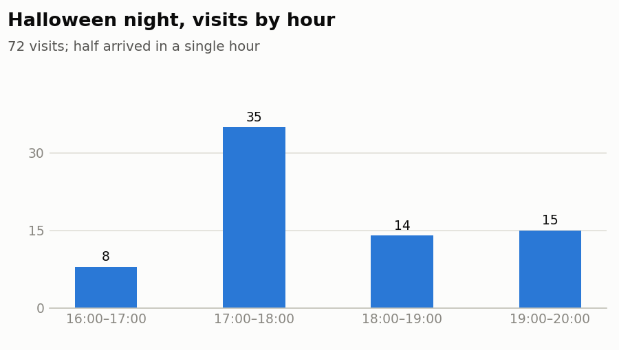
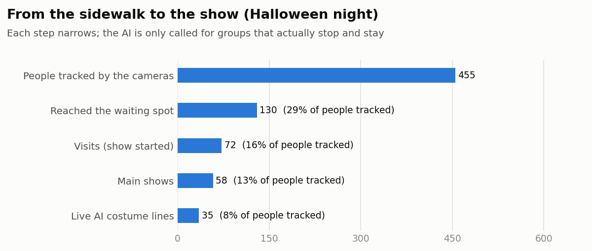
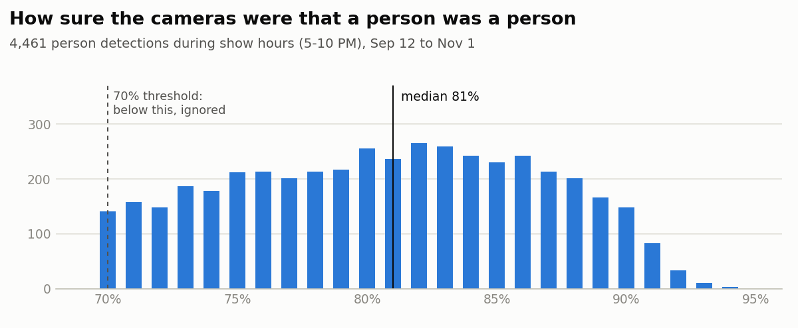
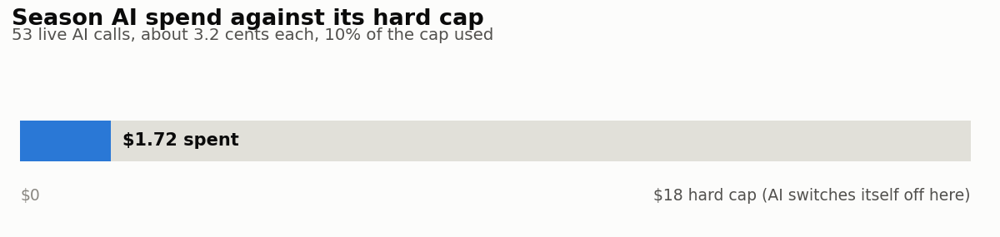
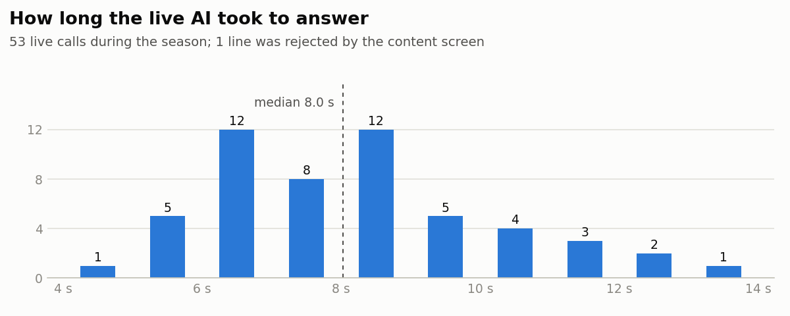
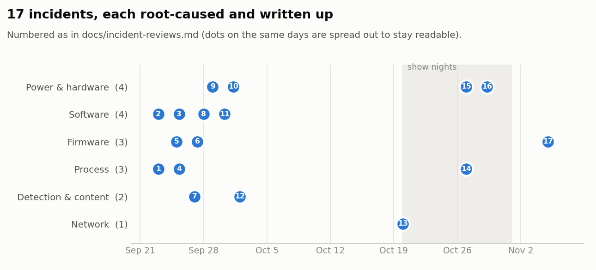

# Harvest of Shadows

[](https://github.com/joe-pero/harvest-of-shadows/actions/workflows/tests.yml)

**A fraud program leader's system build: a 14-controller, AI-assisted haunted yard, designed, built and run end to end.**

I've spent 20+ years in investigations and fraud, most recently as Senior Manager,
Investigations & eCommerce Fraud. My work there was building the detection, rules,
case-management and reporting a fraud program runs on, and being accountable for its
results.

Harvest of Shadows is that same discipline pointed at a different problem. I designed the
architecture, wrote the rules, set the governance, built the hardware and owned the
outcome on the night. It detects an event, decides with rules, uses AI only where it
earns its place, caps vendor spend, logs every outcome and never lets a failure go
silent. This repo is the code behind the 2026 show.

## Why I'm sharing this

It's a window into how I approach technology and systems, at work or at home: start with
the problem, give every tool a clear job, build in controls, measure the results, and keep
a person in the loop where it matters. And it's been a lot of fun.

I believe we build stronger communities when we collaborate. That goes for my professional
network and for the home haunt and maker community that taught me so much. Take what's
useful, improve it, and send ideas back through an issue. One standalone tool has already
come out of it: [projection-fit](https://github.com/joe-pero/projection-fit), which fits
projected video onto a door or window from one phone photo.



## Try it in one minute (no hardware)

The show logic runs on its own, so you can watch a simulated night on any computer with Python 3:

```bash
git clone https://github.com/joe-pero/harvest-of-shadows
cd harvest-of-shadows/orchestration
python3 -m showsim.demo
```

It drives the same state machine the live show runs, with a scripted mix of visitors (people
walking past, groups who stop, hesitate, linger for an encore or leave early):

```
17:32:34  group  2: stops at the waiting spot (older group) -> pre-show, theme Mutant Pumpkins, tone scary
17:33:22            hesitates: 1 "still standing there?" taunt
17:33:30            walks up the path -> MAIN SHOW: narrator outro, then the whole yard on one cue
17:43:36  group  4: stops at the waiting spot (AI unsure) -> pre-show, theme Return of the Living Dead, tone scary
17:44:02            walks up the path -> MAIN SHOW: narrator outro, then the whole yard on one cue
17:44:57            still on the path -> ENCORE (same theme, banter only, no new show)
18:01:37     ! mainshow cue NOT confirmed (narrator status link down): flagged for review
...
Night summary (1 h 07 min simulated)
  Visits (stopped at the waiting spot)     8
  Main shows                               7
  Encores                                  2
  Cues sent to the yard                    26
  Cues flagged as unconfirmed              1
```

Options: `--groups 30`, `--seed 7` (same seed = same night), `--verbose` (every state-machine
step and the narrators' lines), `--pace 0.02` (watch it play out in real time).

## The 2026 season at a glance

Live season: 10 show nights, October 20 to November 1. Every number comes from the show's own
event log, the camera system's records or the AI usage ledger.

**Detection**

| Measure | Result |
|---|---|
| People detected by the cameras (Sep 12 to Nov 1) | **11,242**, of which **4,504** during show hours |
| Detection confidence that a "person" is a person | median **81.5%** during show hours (90% of detections above 73%); nothing under the **70%** threshold is counted |
| Zone entries logged (6 camera zones) | **3,372** |
| Events logged by the show over the whole build | **11,281**, across 10 event types |

**The show**

| Measure | Result |
|---|---|
| Visits | **183**, including **72** on Halloween night |
| Main shows / encores / "hold" taunts | **135** / **82** / **11** |
| Themes played | Return of the Living Dead **80**, Children of the Corn **56**, Pumpkins **47** |
| Narrator banter choices made live | **265**, from **~3,100** pre-recorded lines in two locally cloned voices |
| Show cues sent over the radio mesh | **531**; **10** flagged by the miss detector, mostly false alarms on investigation (see below) |
| Missed cues, final night | **0** of the night's cues |
| Controllers in the yard | **14** (ESP32, ESP32-A1S, ESP-01S), one leader + 13 followers |

**AI and cost**

| Measure | Result |
|---|---|
| Live AI calls | **53**; on Halloween **35 / 35** placed, **0** errors, **0** fallbacks |
| AI response time, Halloween | median **7.5 s**, slowest **12.6 s** (the recorded intro covers the wait) |
| Total AI cost for the season | **$1.72** (about **3 cents** a call), under a hard **$18** lifetime cap |
| Visitor photos stored | **None.** The frame lives in memory for one call, then it's gone |

**When the numbers looked wrong:** on Halloween the miss detector flagged 4 intros as not played.
Cross-checking the narrator boards' own file downloads showed 3 had played (the board's status link
had dropped for a few seconds) and 1 most likely hadn't (two groups arrived 3 seconds apart). The
fixes for next season: separate "not played" from "couldn't confirm", re-send cues after a dropout,
and hold a second group's intro until the first finishes. All 17 of the season's incidents are
written up in [docs/incident-reviews.md](docs/incident-reviews.md).

## How it works

1. **Detect.** Yard cameras feed an object-detection server. People are tracked through
   zones drawn on the camera image; a visit starts when a group reaches the viewing spot.
2. **Decide.** A Python service ([`orchestration/livebridge`](orchestration/livebridge))
   runs each visit: theme, tone (friendly for little kids, scary for everyone else), and
   what the narrators say.
3. **Lead.** The Scarecrow narrator board receives the visit over Wi-Fi and broadcasts every
   cue to the yard over **ESP-NOW** (device-to-device radio, no router in the path).
4. **Follow.** Every other prop listens to the Scarecrow and does one job: follow the cue.
   Duplicates are ignored, cues from anyone else are ignored *and counted*, and a prop that
   loses its leader finishes its track and returns to idle on its own.

### One visit, as a state machine



Theme and tone lock when the pre-show starts and can't change mid-visit. These paths are exercised by
the tests (including six-hour random soaks), and you can watch it run with `python3 -m showsim.demo`.

## The season in charts

The tables above, drawn. Every chart is built from one aggregate data file
([`docs/charts/season_2026.json`](docs/charts/season_2026.json)) by [`tools/make_charts.py`](tools/make_charts.py);
nothing in it identifies a visitor. Charts follow your GitHub light or dark theme.

**Demand.** Visits rose through the season and peaked on Halloween. Most groups that stopped also
walked up for the full show. The one empty night is the camera outage still listed as an open item.

<picture>
  <source media="(prefers-color-scheme: dark)" srcset="docs/charts/season-nights-dark.png">
  
</picture>

**Peak load.** Half of Halloween's visits arrived in one hour. Groups 3 seconds apart are what exposed
the one real missed intro, and the fix (hold the next group's intro until the current one ends) is
planned for next season.

<picture>
  <source media="(prefers-color-scheme: dark)" srcset="docs/charts/halloween-hours-dark.png">
  
</picture>

**Detection funnel.** Hundreds of people pass by; only groups that stop and stay start a show, and
only those trigger a paid AI call. Spend follows real engagement, not foot traffic.

<picture>
  <source media="(prefers-color-scheme: dark)" srcset="docs/charts/halloween-funnel-dark.png">
  
</picture>

**Detection quality.** The cameras' confidence that a detected person really is a person. Anything
under the 70% threshold is ignored, which is why trees and shadows didn't start shows.

<picture>
  <source media="(prefers-color-scheme: dark)" srcset="docs/charts/detection-confidence-dark.png">
  
</picture>

**AI cost and speed.** The whole season's AI bill, against the hard cap that switches AI off by
itself. The call runs while the recorded intro plays; if an answer isn't back in time, a recorded
line is used instead, so a slow call never leaves a visitor waiting in silence.

<picture>
  <source media="(prefers-color-scheme: dark)" srcset="docs/charts/ai-spend-dark.png">
  
</picture>

<picture>
  <source media="(prefers-color-scheme: dark)" srcset="docs/charts/ai-latency-dark.png">
  
</picture>

**Reliability.** Every failure found during the build, by type and date. Most surfaced in testing,
weeks before the show nights, which is the point of testing early. Full write-ups:
[docs/incident-reviews.md](docs/incident-reviews.md).

<picture>
  <source media="(prefers-color-scheme: dark)" srcset="docs/charts/incidents-dark.png">
  
</picture>

## Same discipline, different domain

| How I run a fraud program | How it shows up in this build |
|---|---|
| **Own the architecture** | One leader, defined follower behavior, one message contract across 14 devices. Every part has a clear owner and a failure plan. |
| **Rules before models** | The AI gets one narrow job (headcount + a short costume description). Everything around it is pre-recorded and rule-driven. |
| **Screening and rejection** | Every AI phrase passes an interpretation layer, then a screen that rejects anything about bodies, faces, skin or protected traits. A rejected phrase is never "fixed up"; the visit falls back to a recorded line. See [`orchestration/vision/middle_pipeline.py`](orchestration/vision/middle_pipeline.py). |
| **Vendor spend controls** | Cooldown between calls, daily cap, hard lifetime cap that shuts AI off automatically, and a schedule limited to trick-or-treat hours. See [`orchestration/livebridge/middle_audio.py`](orchestration/livebridge/middle_audio.py). |
| **False-positive tuning** | Camera zones and motion masks were audited against real walk-throughs. Reported "skipped intros" on Halloween were investigated: 3 of 4 had actually played. |
| **No silent failures** | Every cue is logged with an outcome. Narrator-to-narrator handoffs use a confirm/ACK/timeout handshake. An audio module that doesn't confirm playback is logged immediately. |
| **Privacy by design** | No visitor images are saved. Visitor data stays local and is never published. |
| **Measure it, report it** | Every visit is written to a JSON event log; [`tools/show_report.py`](tools/show_report.py) turns a night into the numbers above. |
| **Root cause, then fix the class** | When something failed on a live night, it got a written incident review and a fix applied to every device with the same weakness, not just the one that broke. |

## AI in this project

This build uses AI in several places, each chosen for a specific job and each kept on a
short leash. I set the requirements, the rules and the limits, and I made the calls.

**Inside the live show**

| AI | Its one job | The control around it |
|---|---|---|
| Object-detection model (Frigate, on a GPU) | Spot people in the yard's camera zones | Zones and masks tuned against real walk-throughs to cut false triggers |
| OpenAI vision model | Count the group and name a costume in 14 words or less | Content screen, recorded fallback, cooldown, daily cap, hard lifetime spend cap |
| XTTS-v2 voice cloning (runs locally) | Speak the narrators' ~3,100 lines and the live costume phrase | Every rendered line checked by an automated transcript test before it ships |

**Used to build it**

| AI | What it did |
|---|---|
| AI coding assistants: OpenAI Codex, Anthropic Claude, Google Gemini | Pair-programmed firmware, Python and docs. Codex started the early code; Claude carried most of the build; Gemini filled in when usage limits ran out. I directed the design, tested on real hardware and approved every change. Claude-assisted commits are co-credited. |
| Suno | Generated original songs for the Singing Pumpkins |
| Adobe Character Animator | Lip-synced the singing pumpkin faces to those songs |

## What's in this repo

| Folder | What it is |
|---|---|
| [`orchestration/livebridge`](orchestration/livebridge) | The live show service: camera events in, visit decisions, AI insert, MQTT cues out |
| [`orchestration/showsim`](orchestration/showsim) | The show state machine, runnable as a simulator without hardware |
| [`orchestration/vision`](orchestration/vision) | The narrow AI call, interpretation layer and content screen |
| [`props/scarecrow-narrator-a1s`](props/scarecrow-narrator-a1s) | Show leader: ESP32-A1S audio board, Wi-Fi + ESP-NOW broadcaster |
| [`props/skeleton-narrator-a1s`](props/skeleton-narrator-a1s) | Second narrator, handshakes with the Scarecrow |
| [`examples/first-follower`](examples/first-follower) | **Start here to add your own prop:** the smallest follower that joins the cue network, plus a test sender |
| `props/*` | One folder per follower prop: spatial-audio speakers, crows, projectors, DMX, IR lights, fog, relays |
| [`shared`](shared) | The common ESP-NOW message contract, follower logic, diagnostics and a hardened MP3 driver |
| [`docs/hardware-gotchas.md`](docs/hardware-gotchas.md) | Every hardware lesson I paid for, so you don't have to |
| [`docs/incident-reviews.md`](docs/incident-reviews.md) | 17 incidents from the season: root cause, fix, and the pattern behind them |
| [`docs/remote-flashing-over-a-pi.md`](docs/remote-flashing-over-a-pi.md) | Flash and debug yard props over a Raspberry Pi, safely |
| [`docs/control-dashboard.md`](docs/control-dashboard.md) | The garage wall display that ran the show |
| [projection-fit](https://github.com/joe-pero/projection-fit) (separate repo) | Fits the door and window projections from one photo of a marker card |

## Build it yourself

Firmware uses [PlatformIO](https://platformio.org/). Secrets are never in the code:

1. Copy `shared/Shared_Constants/wifi_credentials.h.template` to `wifi_credentials.h` and
   fill in your own Wi-Fi and MQTT details.
2. Copy `orchestration/livebridge/.env.template` to `.env` and `orchestration/mqtt_credentials.py.template` to `mqtt_credentials.py` for the Python service.
3. Device MAC addresses in `shared/Shared_Constants/ProjectConstants.h` are zeroed; set
   your own boards' MACs.
4. All radios are locked to Wi-Fi channel 11. Change it in one place if your network differs.

Not included: voice clones, music, video and show audio (third-party or licensed material),
camera layouts and anything about the people who visited.

## Tests

Every push runs two sets of checks (see [`.github/workflows/tests.yml`](.github/workflows/tests.yml)):

- **Show logic**, with no hardware: the visit state machine, theme rotation, narrator banter
  selection, live-insert fitting, the show clock, failure hardening (watchdogs, visit time limits),
  the AI content screen (cases that must pass and must be rejected), and the simulated night,
  which has to agree with the state machine across 20 seeded nights.
- **Firmware**: all 16 props and the first-follower example are compiled from a clean copy using only the credentials
  templates, the same way anyone cloning the repo would build them.

## Roadmap

See [ROADMAP.md](ROADMAP.md).

## License

MIT. See [LICENSE](LICENSE).
