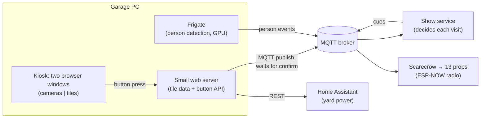

# The garage display: a control panel for the show

The show had no app and no laptop on the night. It was run from a wall display in the garage:
two monitors in kiosk mode on a small PC that also does the camera work. One side shows the
cameras; the other is a tile dashboard with the household basics (weather, temperature) and
three buttons that run the yard.

This is a write-up of how it works and what it took to make it reliable. The dashboard
itself is tied to my home setup, so the code isn't published, but the patterns carry over to
any home-built control panel.

## Three buttons

| Button | What it does | Cost |
|---|---|---|
| **AI Show** | Arms the live AI costume line | paid calls, capped |
| **Free Show** | Runs the show with pre-recorded lines only | $0 |
| **Show Power** | One checked power-up / safe shutdown of the yard ([show-power](https://github.com/joe-pero/show-power)) | electricity |

Props play when either show button is on.

**A button only shows success when the system confirms it.** Pressing a button sends an
explicit target state ("turn ON", never "toggle") and waits for the broker or Home Assistant to
report back. A toggle that silently failed is worse than no button at all, because you'd trust
it.

**Safe defaults after a restart.** The AI Show always comes back OFF after the show service
restarts, so a crash or an update can never leave paid calls running unattended. The Free
Show keeps its setting, because it costs nothing.

**The Show Power note tells the truth.** After OFF it reads "shutting down: projectors
cooling…", then "all off, safe" only once the projector circuits really are off, or a warning
naming what's still powered.

## Making a kiosk that stays up

A wall display has to survive reboots, power cuts, monitor swaps and nights of being blanked.
Each of these broke it at least once:

- **Monitor names changed after a GPU swap.** The scripts had the video output names hardcoded.
  After the swap every layout command failed with a quiet "output not found; ignoring" for
  weeks, until one night a monitor went black and stayed black. Fix: find monitors at runtime
  by their **identity (model and serial number)**, never by port name.
- **"Turn it off and on again" has to be real.** A soft reset left one panel black. Fix: a
  genuine mode-set cycle: every output off, a short pause, then positioned back on.
- **Browser windows hang without crashing.** A watchdog checks a heartbeat file that each page
  updates; if a heartbeat goes stale, that window is relaunched. A process that's "running" but
  frozen counts as down.
- **Tiles were "unavailable" for 5 minutes after every reboot.** The data fetcher started
  before Home Assistant was ready. Fix: wait (up to 3 minutes) for the services a tile needs
  before building it, instead of failing and retrying on a timer.
- **Times were 8 hours off.** The fetcher's container ran in UTC, so evening events showed on
  the next day. Fix: set the container's time zone explicitly, and document that every
  local-time calculation in it assumes local time.

## The pattern behind all of it

1. **Confirm, don't assume:** a button, a switch, a cue or a tile isn't "done" until something
   downstream reports it.
2. **Fail safe:** the paid feature defaults off; the projector stays powered rather than
   being hard-cut.
3. **Identify things by what they are, not where they're plugged in.**
4. **Treat "frozen" the same as "crashed".**
5. **When the numbers look wrong, read the raw data before changing code.** The
   8-hours-off bug took minutes once the raw tile data was compared with the source.
