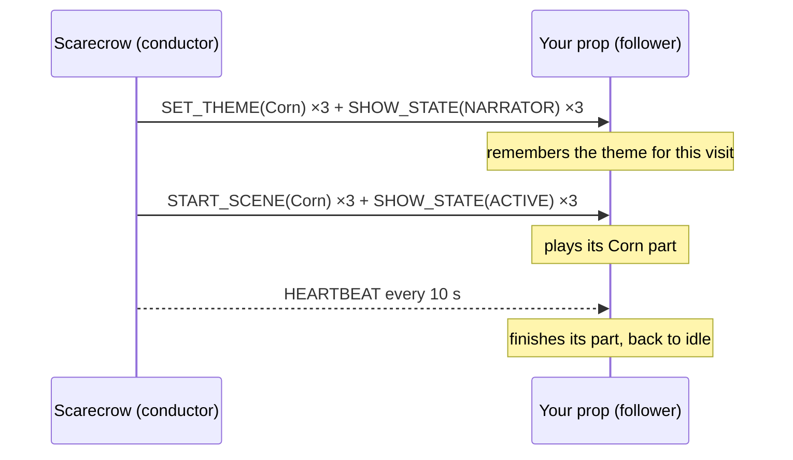

# Your first follower prop

The smallest prop that joins the Harvest of Shadows cue network. Start here if you want to add
your own prop to a show like this one.

## The idea: one conductor, many followers

The Scarecrow is the conductor. For each visit it broadcasts a few short radio messages:
"the theme is Corn", "the narrators are talking", "show starts now". Every other prop is a
**follower**: it listens, and when the show starts it plays its part for that theme. Followers
never talk to each other and never need to know who else is in the yard, so you can add or
remove a prop without changing anything else.



## What you need

- One ESP32 dev board (two if you want to test without a show), a USB cable
- [PlatformIO](https://platformio.org/) (VS Code extension or command line)

## Try it

```bash
cd examples/first-follower
pio run -e follower    -t upload && pio device monitor     # board 1: the prop
pio run -e test_sender -t upload                           # board 2: pretends to be the Scarecrow
```

The prop's built-in LED blinks a different pattern for each theme (slow for Corn, frantic for
Return of the Living Dead, a double blink for Mutant Pumpkins) for 30 seconds, then goes back
to a short idle blip. The serial monitor explains every decision:

```
[   4.3s] theme latched
[   4.3s] visit started (SHOW_NARRATOR)
[  12.4s] SHOW_ACTIVE -> theme track
            -> SHOW: Return of the Living Dead pattern for 30 s
[  42.4s] theme track done
            -> back to idle
[status] plays=1 repeats_ignored=2 other_senders=0 bad_frames=0 leader=ok
```

(The exact lines and counts depend on timing.)

The test sender pretends to be the Scarecrow, so **don't run it near a live show**.

## Make it your prop

Replace `ledShow()` in [`src/follower/main.cpp`](src/follower/main.cpp) with your hardware:
switch a relay, move a servo, start an MP3 track (and call `follower.onTrackEnd()` when it
finishes), or run a light pattern. Set `TRACK_MS` to how long your part lasts.

## The message format

Every message is the same 22 bytes ([`shared/Shared_Constants/ProjectConstants.h`](../../shared/Shared_Constants/ProjectConstants.h)):

| Bytes | Field | Meaning |
|---|---|---|
| 0 | magic | always `0xA5` |
| 1 | version | `1` |
| 2 | command | e.g. `SET_THEME 0x02`, `START_SCENE 0x01`, `SHOW_STATE 0x28`, `HEARTBEAT 0x40` |
| 3 | sender | who sent it (the Scarecrow is `0x06`) |
| 4 | target | `0xFF` = everyone |
| 5 | flags | `0` |
| 6-9 | session | one number per visit |
| 10-11 | seq | counts up with every message |
| 12-15 | payload A | the theme, or the show state |
| 16-19 | payload B | usually `0` |
| 20-21 | CRC16 | a checksum of bytes 0-19; anything that doesn't match is dropped |

All boards sit on **one fixed Wi-Fi channel** (`WIFI_CHANNEL`, 11 by default). If your access
point is on a different channel, change it everywhere, or the boards won't hear each other.

## Why the follower logic is a separate, tested file

Radio is lossy and props are out in the weather, so the follower decisions live in
[`ShowFollower.h`](../../shared/Shared_Constants/ShowFollower.h), the same file every prop in the
real show uses, with host-side tests. It handles the cases that are easy to get wrong:

- **Only the conductor counts.** Messages from anyone else are ignored and counted.
- **Repeats are ignored.** Every cue is sent 3 times, and only the first one acts.
- **No guessing.** A prop plays the theme it was told for *this* visit, or stays idle.
- **Always finishes.** If the conductor goes quiet mid-show, the prop still finishes and returns to idle.
